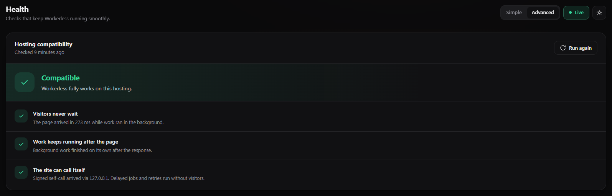
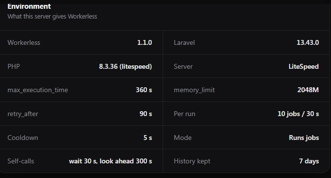

<p align="center">
    
</p>

<h1 align="center">Workerless</h1>

<p align="center"><strong>Laravel queues that just work.</strong><br>No cron, no SSH, no <code>queue:work</code> to keep alive.</p>

<p align="center">
    <a href="https://github.com/himacode-company/workerless/actions/workflows/tests.yml"></a>
    <a href="https://packagist.org/packages/himacode-company/workerless"></a>
    <a href="https://packagist.org/packages/himacode-company/workerless"></a>
    <a href="LICENSE"></a>
</p>

---

Laravel queues need a worker: `php artisan queue:work`, running all the time. On shared hosting you usually cannot keep one alive, so you end up with a cron entry, the right PHP binary path, the right PHP version for the CLI, and a silent failure the day one of them is wrong.

**Workerless removes all of that.** Your jobs are stored in the normal `jobs` table and run **right after the response is sent**, inside the same PHP that serves your site. Visitors never wait, and there is nothing to keep alive.

## Who is it for

| You are on | What Workerless gives you |
| --- | --- |
| **Shared hosting** (Hostinger, cPanel, Plesk...) | Real queues with no cron, no SSH, no supervisor. `composer require` and one line in `.env`. |
| **Your own machine** | No terminal running `queue:work`, and no stale worker running old code: every job runs with your latest code. |
| **A VPS** | Keep your own `queue:work` and use Workerless as a **lightweight Horizon for the database queue**: history, failed jobs with retry, throughput, health. |

## Features

- **Zero setup.** `composer require` and `QUEUE_CONNECTION=workerless`. No cron, no SSH, no hPanel or cPanel step.
- **Same PHP as your site.** No CLI PHP binary to find, no version mismatch between your site and your cron.
- **Real Laravel queues.** Built on Laravel's own `DatabaseQueue` and Worker: `$tries`, `$backoff`, `delay()`, `failed_jobs`, `queue:retry` and queue events all keep working.
- **Visitors never wait.** The response is finished first, then jobs run.
- **Delays and retries without visitors.** A chain of signed self-calls keeps them moving, and survives a crashing job.
- **Clean jobs.** Each job starts from a clean state, like `queue:work`: no visitor login, request or locale leaks into it.
- **Hosting check built in.** One click tells you if your hosting is *Compatible*, *Works with limits* or *Not compatible*, and why.
- **Dashboard.** Simple mode (is everything fine?) and Advanced mode (chart, jobs, failed jobs, history, health). Light and dark.
- **No tables to create.** Workerless creates them, and ships a migration so `migrate:fresh` keeps working.
- **Secure by default.** No shell commands ever, signed one-time self-calls, a dashboard that returns 404 to anyone not allowed.
- **No lock-in.** Outgrow shared hosting? Run `php artisan queue:work` on the same `jobs` table. Nothing else changes.

## Installation

**1. Install** (in `require`, not `require-dev`: it runs in production)

```bash
composer require himacode-company/workerless
```

This also:

- copies the config file to **`config/workerless.php`** in your app, ready to edit (an existing file is never overwritten),
- adds `WORKERLESS_USER_IDS=` to your `.env` and a hint above `QUEUE_CONNECTION`.

**2. Use it** in `.env`

```env
QUEUE_CONNECTION=workerless
WORKERLESS_USER_IDS=1
```

`WORKERLESS_USER_IDS` lists the ids (from your `users` table) of the people allowed to open the dashboard in production.

**3. Check your hosting.** Upload your app, log in, open `/workerless` and press **Check this hosting**. In about 5 seconds you know if Workerless fully works there.

That's it. Dispatch jobs as usual:

```php
SendWelcomeEmail::dispatch($user);
SendReminder::dispatch($user)->delay(now()->addMinutes(10));
```

## Hosting requirements

These are **server** settings (PHP and your hosting plan), not Workerless options. Most shared hosting plans already meet the recommended column. You do not have to check them by hand: **Check this hosting** in the dashboard tests the important ones for real.

| Server setting | Minimum | Recommended | Why it matters |
| --- | --- | --- | --- |
| PHP | 8.2 | 8.3 or newer | Laravel 12 needs 8.2, Laravel 13 needs 8.3 |
| Web server | Apache mod_php, Nginx + PHP-FPM, or LiteSpeed | **LiteSpeed** or **PHP-FPM** | They finish the response with a built-in function, the cleanest way to answer the visitor first |
| `max_execution_time` | 30 s, if `set_time_limit()` is allowed; otherwise 90 s | 120 s or more | A job may run up to `retry_after` (90 s) |
| `memory_limit` | 128M | 256M, or 512M for PDFs and images | Jobs run in the PHP process that served the page |
| `set_time_limit()` | allowed | allowed | Lets each job use its full time budget |
| `ignore_user_abort()` | allowed | allowed | Work continues after the visitor leaves |
| PHP `curl` extension | optional | **enabled** | Needed for self-calls (delays and retries without visitors) |
| Site can reach itself | optional | **yes** (via `127.0.0.1` or its public URL) | Same: self-calls. Firewalls and some CDN rules can block it |
| `storage/framework` writable | **required** | required | Workerless keeps tiny state files there |
| Database user can `CREATE TABLE` | **required**, unless you run `migrate` | required | Tables are created automatically on the first job |
| `APP_KEY` set, `APP_URL` = real address | **required** | required | Self-calls are signed with `APP_KEY` and sent to `APP_URL` |
| Concurrent PHP processes (entry processes) | 10 | 20 or more | Workerless uses one or two of them at most |

**Not needed at all:** SSH, cron, Supervisor, Redis, `exec()`, `proc_open()` or any shell access.

### Tested in production

Hostinger Business shared hosting, LiteSpeed, PHP 8.3, Laravel 13, sending real emails with PDF certificates, no cron:

<p align="center">
    
</p>

<p align="center">
    
</p>

## How it works

1. A job is dispatched and stored in the `jobs` table.
2. The current response is sent to the visitor (`litespeed_finish_request`, `fastcgi_finish_request`, or a closed connection on Apache mod_php).
3. Right after, in the same PHP process, Workerless runs the due jobs with Laravel's Worker, within time and job limits, one run at a time.
4. If more work is due soon (a big batch, a delay, a retry), Workerless sends a signed request to itself, which waits and runs it, then passes the baton to the next one, even if nobody visits the site.

Only one run happens at a time. When many visitors arrive together, the others skip running jobs and finish immediately, so Workerless uses **at most one or two PHP processes** of your hosting, however busy your site is.

A batch of 100 emails is 100 jobs: Workerless runs them 10 at a time, back to back, until the queue is empty. Follow it live in the dashboard.

## Dashboard

Open `/workerless`.

- **Simple mode** (default): is everything working, how many jobs are waiting, done and failed, and the failed jobs with Retry and Delete.
- **Advanced mode:** throughput chart, all jobs, failed jobs, history, health checks, hosting check and server details.

### Who can open it

| Who | How |
| --- | --- |
| Specific users | `WORKERLESS_USER_IDS=1,7` in `.env`. They must be logged in to your app. |
| Your own rule | A `viewWorkerless` gate, e.g. in `AppServiceProvider::boot()`: |
| You, while developing | The `local` environment, from the same machine (`127.0.0.1`) only. |

```php
use Illuminate\Support\Facades\Gate;

Gate::define('viewWorkerless', fn ($user) => $user->is_admin);
```

Everyone else gets a **404**, so nobody can tell the dashboard exists. A site uploaded with `APP_ENV=local` by mistake stays protected.

## Configuration

Everything works out of the box. To change something, either:

- set a key in **`.env`** (best: each server can have its own value), or
- edit **`config/workerless.php`** in your app. Every option is explained right there.

If your server ran `php artisan config:cache`, run `php artisan config:clear` after changing `.env`.

| `.env` key | Default | What it does |
| --- | --- | --- |
| `WORKERLESS_ENABLED` | `true` | `false` = monitoring mode (for a VPS, see below) |
| `WORKERLESS_USER_IDS` | empty | User ids allowed to open the dashboard |
| `WORKERLESS_MAX_JOBS` | `10` | Jobs per run |
| `WORKERLESS_MAX_SECONDS` | `30` | Stop taking new jobs after this many seconds |
| `WORKERLESS_COOLDOWN` | `5` | Seconds between two runs |
| `WORKERLESS_QUEUES` | connection queue | Queues to run, by priority, e.g. `high,default` |
| `WORKERLESS_LOOPBACK` | `true` | Self-calls for delays and retries without visitors |
| `WORKERLESS_URL` | `APP_URL` | Address used for self-calls |
| `WORKERLESS_MAX_WAIT` | `30` | Longest one self-call waits for the next job (seconds) |
| `WORKERLESS_HORIZON` | `300` | How far ahead the self-call chain stays alive (seconds) |
| `WORKERLESS_VERIFY_SSL` | `true` | Keep `true` in production |
| `WORKERLESS_DASHBOARD` | `true` | Turn the dashboard off |
| `WORKERLESS_PATH` | `workerless` | Dashboard URL |
| `WORKERLESS_KEEP_DAYS` | `7` | Days of job history to keep |

**Common recipes**

```env
# Empty big batches (hundreds of emails) faster
WORKERLESS_MAX_JOBS=20
WORKERLESS_MAX_SECONDS=45
WORKERLESS_COOLDOWN=2

# Run urgent jobs first
WORKERLESS_QUEUES=high,default

# Dashboard at /admin/queue
WORKERLESS_PATH=admin/queue
```

**After upgrading Workerless**, new options already work with their defaults. To see them in your config file, publish it again (this replaces your copy, so note your changes first):

```bash
php artisan vendor:publish --tag=workerless-config --force
```

## On a VPS: a lightweight Horizon

Have a real worker? Keep it, and let Workerless watch it. Horizon needs Redis; Workerless works with the **database queue**.

```env
QUEUE_CONNECTION=workerless
WORKERLESS_ENABLED=false
```

Run your worker as usual (Supervisor, systemd...):

```bash
php artisan queue:work
```

Workerless then runs nothing itself. Your worker runs the jobs, and the dashboard shows them: history, failed jobs with retry, throughput and health.

## When to use it, and when not

**Great for** small and medium apps on shared hosting: emails, notifications, certificates and PDFs, webhooks, image resizing, short API calls.

**Not for:**

- **High volume.** Up to `WORKERLESS_MAX_JOBS` jobs per run, one run at a time. Thousands of jobs per hour need a real worker.
- **Long jobs.** A job must finish within `retry_after` (90 s by default). Video processing or huge exports need a real worker.
- **Exact timing with no traffic.** Work due within 5 minutes runs on time. A job delayed by hours runs at the first visit after its time.
- **Several servers** behind a load balancer, or Laravel Octane.

Each run uses one PHP process of your hosting, so during a heavy batch (PDFs, images) one CPU core is busy. A cron-driven `queue:work` costs the same.

**Tip:** dispatch one job per email or per item, never one job that loops over hundreds. Small jobs are retried one by one; a giant job that times out starts over from the beginning.

## Tables

Workerless creates `jobs`, `failed_jobs` and `workerless_runs` by itself, and also ships a migration, so `php artisan migrate` and `migrate:fresh` keep working. Do not run `php artisan queue:table`: the `jobs` table already exists.

## FAQ

**Can I still use `queue:work`?** Yes. Workerless uses the standard `jobs` table, so a real worker can process the same jobs at any time. On a VPS, use monitoring mode.

**What if a job crashes the PHP process?** The run releases its lock and passes the baton to the next self-call before PHP exits, so the rest of the queue keeps moving.

**Does it work behind Cloudflare?** Usually yes: self-calls go to `127.0.0.1` first, so they never leave the server. If they are blocked, the hosting check tells you.

**What if my hosting is not compatible?** The hosting check says so, and why, before you rely on it. Your jobs stay safely in the `jobs` table.

**Is it safe?** See [SECURITY.md](SECURITY.md). No shell commands are ever run, self-calls are signed and can be used only once, and the dashboard is invisible to anyone not allowed.

## Requirements

- PHP 8.2+
- **Laravel 12 or 13**: fully supported and tested on every PHP version in CI.
- Laravel 10 or 11: still installs, but both are end of life and no longer receive security fixes, so recent Composer versions may refuse to install them and they are not tested in CI. Upgrading is strongly recommended.
- A database supported by Laravel's database queue (MySQL, MariaDB, PostgreSQL, SQLite, SQL Server)

## Security

Please report vulnerabilities privately, see [SECURITY.md](SECURITY.md).

## License

MIT. See [LICENSE](LICENSE).

---

<div dir="rtl">

## بالعربية

**Queue في Laravel تعمل وحدها:** بلا Cron، ولا SSH، ولا `queue:work` تحتاج أن تبقيه شغّالًا.

على الاستضافة المشتركة تحتاج عادة إلى Cron، ومسار PHP الصحيح، وإصدار PHP الصحيح لسطر الأوامر، ثم يفشل كل شيء بصمت يوم يخطئ واحد منها. Workerless تحفظ الـ Jobs في جدول `jobs` المعتاد، وتنفّذها مباشرة **بعد إرسال الصفحة للزائر**، داخل نفس PHP الذي يشغّل موقعك. فلا ينتظر أحد، ولا شيء تحتاج أن تبقيه شغّالًا.

### لمن هي؟

- **الاستضافة المشتركة:** Queue حقيقي بلا Cron ولا SSH.
- **جهازك أثناء التطوير:** لا نافذة Terminal مفتوحة لـ `queue:work`، وكل Job يعمل بآخر نسخة من الكود.
- **VPS:** أبقِ `queue:work` الخاص بك، واستخدم Workerless كـ **Horizon خفيف** لطابور قاعدة البيانات، عبر `WORKERLESS_ENABLED=false`.

### التثبيت

1. `composer require himacode-company/workerless`، وسيظهر ملف الإعدادات `config/workerless.php` في تطبيقك تلقائيًا، مع شرح لكل خيار.
2. في `.env`: `QUEUE_CONNECTION=workerless` و`WORKERLESS_USER_IDS=1` (أرقام المستخدمين المسموح لهم بفتح اللوحة).
3. ارفع تطبيقك، وسجّل الدخول، وافتح `/workerless`، واضغط **Check this hosting**. خلال 5 ثوانٍ تعرف هل تعمل Workerless على استضافتك بالكامل.

### متطلبات الاستضافة

هذه إعدادات **السيرفر** نفسه، وليست إعدادات Workerless. ومعظم الاستضافات المشتركة تحققها أصلًا، وزر **Check this hosting** يفحص المهم منها فعليًا:

- **Laravel:** الدعم الكامل والمختبَر لـ **Laravel 12 و13**. أما 10 و11 فما زالت تُثبَّت، لكن دعمهما الأمني انتهى ولا نختبرهما، وننصح بالترقية.
- **PHP:** الحد الأدنى 8.2، والموصى به 8.3 أو أحدث.
- **السيرفر:** يعمل على Apache وNginx وLiteSpeed، والأفضل **LiteSpeed** أو **PHP-FPM**.
- **max_execution_time:** الحد الأدنى 30 ثانية (إن كانت `set_time_limit` مسموحة)، والموصى به 120 ثانية أو أكثر.
- **memory_limit:** الحد الأدنى 128M، والموصى به 256M، أو 512M لملفات PDF والصور.
- **إضافة curl:** موصى بها، لأن الـ Jobs المؤجلة وإعادة المحاولة بلا زوار تحتاجها.
- **مجلد storage/framework قابل للكتابة**، و**مستخدم قاعدة البيانات يملك صلاحية CREATE TABLE**، و**APP_KEY وAPP_URL مضبوطان:** مطلوبة كلها.
- **لا تحتاج أبدًا:** SSH، ولا Cron، ولا Supervisor، ولا Redis، ولا أي أوامر Shell.

جُرّبت في Production على استضافة Hostinger Business (LiteSpeed وPHP 8.3 وLaravel 13)، ترسل إيميلات حقيقية مع شهادات PDF، بلا Cron.

### تعديل الإعدادات

عدّل القيم من ملف `.env` (الأفضل)، أو من `config/workerless.php` في تطبيقك. كل خيار مشروح داخل الملف نفسه، وكل المفاتيح في جدول **Configuration** أعلاه.

### مناسبة لـ

الإيميلات، والإشعارات، والشهادات وملفات PDF، والـ Webhooks، والمهام القصيرة. وليست للكميات الضخمة جدًا أو الأعمال الطويلة جدًا. وإذا كبر تطبيقك، شغّل `queue:work` على الجدول نفسه دون أي تغيير.

</div>

---

<p align="center">Made by <a href="https://github.com/himacode-company">HimaCode</a></p>
